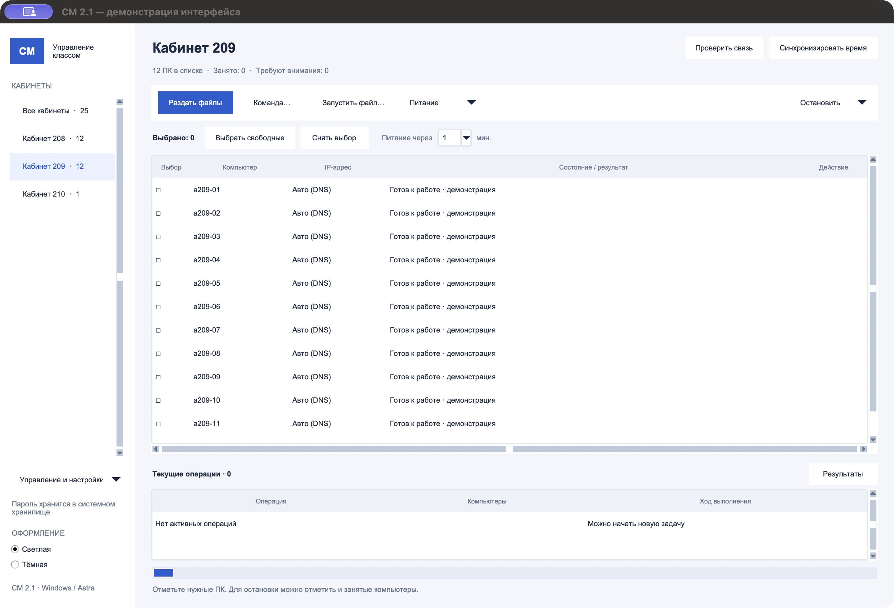
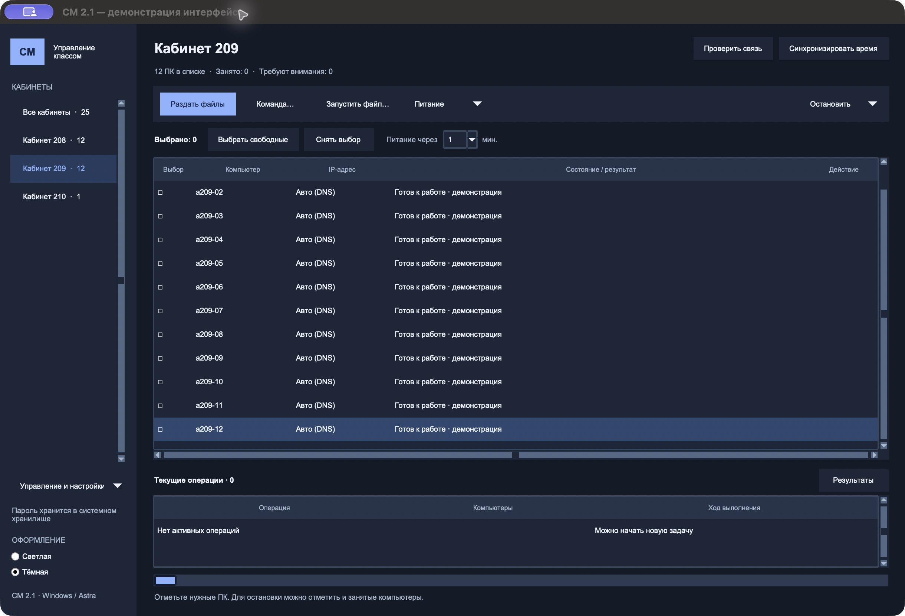

<div align="center">

# Class Manager · CM

### Управление школьным компьютерным классом из одного окна

**Раздавайте файлы, запускайте команды и следите за каждым компьютером.**

`Версия 2.4` · `Учитель: Windows / Astra Linux` · `Ученики: Astra Linux 1.8.4`

[Скачать последнюю версию](https://github.com/shlomasn/class-manager/releases/latest) · [Все выпуски](https://github.com/shlomasn/class-manager/releases) · [Подробная инструкция](README-RU.txt)

</div>

---

**Class Manager** — настольная программа для учителя и администратора школьных компьютеров. Она объединяет кабинеты, передачу учебных файлов, выполнение команд и управление питанием в одной рабочей панели. Для каждого ПК видны состояние, ход операции и результат.

Программа подключается к ученическим ПК по **SSH/SFTP**. После первоначальной установки зависимостей работа выполняется в школьной сети без доступа к Интернету. На ученических ПК нужны доступный SSH, Python 3 и учётная запись с необходимыми правами.

> **Статус: подготовка к школьному пилоту.** Версия 2.4 собрана и прошла автоматические проверки. Синхронизация реальных часов, остановка команд по SSH, системные хранилища паролей и новый интерфейс на Windows/Astra ещё требуют проверки в школе.

## Интерфейс

Рабочая панель CM 2.1 в двух вариантах оформления. Тема переключается прямо в программе.
Снимки настоящего Tk-окна сделаны на macOS с демонстрационными статусами, без подключения к школьным ПК. Рамка окна и шрифты на Windows и Astra могут отличаться.

### Светлая тема



### Тёмная тема



## Возможности

| Направление | Что умеет CM |
| --- | --- |
| **Кабинеты и компьютеры** | Группировка по кабинетам, добавление и изменение ПК, массовый перенос, импорт старых списков `.lst` и `.json`. |
| **Учётные записи ПК** | Логин SSH и пароль для каждого компьютера; пароли только в Windows Credentials/Secret Service. Старые списки используют общий `user`. |
| **Импорт CSV** | Кабинет, имя компьютера и логин, предварительное подтверждение, добавление/обновление без удаления остальных ПК. |
| **Поиск и связь** | Автоопределение локальной подсети, поиск SSH с прогрессом и выбор ПК для добавления; ручной диапазон IP также доступен. |
| **Раздача файлов** | От 1 до 20 файлов всем выбранным ПК одновременно, собственный прогресс каждого компьютера и проверка SHA-256. |
| **Папка назначения** | По умолчанию `~/Desktops/Desktop1/CM-Inbox`; перед раздачей можно выбрать другую папку. При совпадении имени — вопрос о перезаписи. |
| **Отмена раздачи** | Остановка передачи только выбранным ПК; остальные компьютеры и операции продолжают работу. |
| **Команды** | Параллельный запуск Bash-команд, выбор рабочей папки и режима user/sudo, текущий вывод, время выполнения и код завершения. |
| **Запуск переданных файлов** | Выбор полученного `.sh` или `.deb`, подготовка команды и рабочей папки, проверка файла и отдельное подтверждение запуска. |
| **Остановка команд** | Запрос остановки на выбранных ПК без остановки команд на остальных. Подтверждённая остановка отражается в статусе. |
| **Синхронизация времени** | Разовое выравнивание часов выбранных ПК по текущему времени учителя, учёт задержки связи и отчёт о поправке. |
| **Питание** | Выключение, перезагрузка и отмена отложенного действия. Задержка от 0 до 30 минут, подтверждение перед отправкой. |
| **Независимые операции** | Пока одни ПК получают файлы, можно работать с другими свободными ПК. Перед закрытием с активными задачами появляется предупреждение. |
| **Рабочая панель** | Список кабинетов, таблица компьютеров, текущие операции, результаты и переключение светлой/тёмной темы. |
| **Отчёты** | Понятный текст результата и исходный JSON с выводом команды и ошибками. |

## Учётные записи и импорт CSV

В карточке ПК задайте логин SSH и пароль. Режим **«Общий user»** сохраняет привычную общую учётную запись; **«Для этого ПК»** использует отдельную запись хранилища по имени ПК и логину. Пустой пароль не меняет ранее сохранённый пароль той же пары. После смены имени или логина задайте пароль заново. Есть отдельное удаление индивидуального пароля. Если пароль не сохранён, CM запросит его для операции.

В меню управления компьютерами выберите **«Импорт списка .csv / .lst / .json…»**. Формат CSV — UTF-8 (включая BOM) или Windows-1251, разделитель `;`:

```csv
кабинет;компьютер;логин
208;pc-01;user
208;pc-02;admin
209;pc-03;teacher
```

[Скачать шаблон](computers-example.csv). Пароли в CSV не принимаются. Пустой логин означает `user`. Перед импортом CM показывает записи и запрашивает подтверждение. CSV обновляет записи по имени, сохраняя адресацию существующих ПК; остальные компьютеры остаются в списке. Импортированные ПК используют индивидуальные пароли.

## Работа в разных школьных сетях

**Active Directory и собственный DNS-сервер не обязательны.** CM использует обычное разрешение имён операционной системы учителя. В «Управление и настройки → Настройки сети…» можно указать необязательный домен: он добавляется только к коротким именам. Пустое поле означает использование ровно введённого имени; полное имя `pc-01.school.example` используется без добавления домена.

Нахождение в одной сети не гарантирует поиск по имени. CM не запускает собственные mDNS/LLMNR/NetBIOS-службы. Если ОС учителя не находит имя, укажите **постоянный IP** или используйте **поиск по диапазону**. Для DHCP можно настроить резервирование адресов. Старый IP при ошибке разрешения имени автоматически не используется.

Поддерживаются локальные IPv4-сети **`10.0.0.0/8`, `172.16.0.0/12`, `192.168.0.0/16`**, до 512 адресов за один поиск. При поиске можно задать свой логин SSH. Неизвестные SSH-ключи требуют явного доверия; фактическое имя и Astra проверяются до добавления и изменений.

Новая установка начинается **с пустого списка и пустого каталога доверенных ключей**: добавьте свои кабинеты и компьютеры. Сохранённые списки старых установок и пароли остаются; прежний домен сохраняется при миграции. При переносе такого списка в другую сеть очистите или замените домен в настройках. Старые поставляемые списки доступны в `legacy-lists/` для явного импорта.

Ученические ПК по-прежнему должны работать на **Astra Linux 1.8.4** с SSH/Python 3. Нужны права sudo для установки пакетов, питания и синхронизации часов. Поддержка ученических Windows-ПК в этот выпуск не входит. IPv6 не добавлен.

## Найти компьютеры без ввода IP-диапазона

1. Откройте **Управление и настройки → Компьютеры → Найти ПК в моей сети…**.
2. CM прочитает реальные IPv4 и маски активных интерфейсов компьютера учителя. Выберите школьный Ethernet или Wi-Fi: VPN и виртуальные интерфейсы тоже могут попасть в список.
3. Проверьте показанную сеть и нажмите **«Найти компьютеры»**. В небольших сетях проверяется вся подсеть. Сети больше 512 адресов явно разделены на части `/24`: по умолчанию выбрана часть с учителем, номер части можно менять и повторять поиск. Вся большая сеть автоматически не сканируется.
4. Наблюдайте счётчик проверенных IP. Адреса компьютера учителя исключаются. После обнаружения подтвердите SSH-ключи и укажите логин/пароль для проверки имён и Astra.
5. В результатах отметьте нужные ПК и выберите кабинет. **Добавление выполняется только по вашему выбору.**

Определение интерфейсов использует штатный Windows PowerShell/NetTCPIP или `ip` из iproute2 на Astra, без дополнительных Python-пакетов и прав администратора. Ручной **«Найти ПК по IP…»** сохранён. Поиск видит доступные SSH-серверы; выключенные компьютеры, ПК с выключенным SSH или закрытым портом не обнаруживаются этим способом. Автоопределение Windows/Astra требует реального пилота; платформенные ответы ОС в тестах подставные.

## Как проходит работа

1. **Выберите кабинет и компьютеры.** Действия применяются к явно выбранным ПК.
2. **Задайте действие.** Для файлов выберите набор и папку, для команд — текст, рабочую папку и права.
3. **Проверьте параметры и подтвердите запуск.** Передача файлов сама по себе ничего не запускает.
4. **Следите за строками ПК.** Каждый компьютер имеет собственный прогресс и результат; завершившийся ПК доступен для следующей задачи.
5. **Откройте результаты.** При необходимости остановите раздачу или команду только на нужном компьютере.

## Установка и запуск

Скачайте **`CM-Astra-2.4.zip`** из [выпуска 2.4](https://github.com/shlomasn/class-manager/releases/tag/v2.4) и полностью распакуйте архив. Один комплект используется для Windows и Astra. Для обычной установки выбирайте приложенный ZIP CM, а не автоматически создаваемый GitHub архив `Source code`.

### Компьютер учителя: Windows

1. Установите **Python 3.9+ с Tcl/Tk**.
2. Откройте распакованную папку и запустите **`Start-CM.cmd`**.
3. При первом запуске потребуется Интернет для подготовки отдельного окружения с Paramiko.

### Компьютер учителя: Astra Linux

В распакованной папке один раз установите зависимости:

```sh
sudo sh Install-CM-Astra.sh
```

Затем запускайте в обычном графическом сеансе учителя:

```sh
sh Start-CM.sh
```

Нужны Python 3.9+, Tk, Paramiko 2.12+ и доступное системное хранилище Secret Service. Подробности установки и связки ключей — в [README-RU.txt](README-RU.txt).

### Ученические компьютеры

Целевая система — **Astra Linux 1.8.4**. Требуются работающий SSH-сервер, Python 3 и выбранная локальная учётная запись; для установки пакетов, питания и изменения времени нужны права sudo. Для управляемых команд требуется Linux Python с `waitid`/`WNOWAIT`.

Новая установка не содержит чужих компьютеров и доверенных ключей. Настройте собственные кабинеты, имена, адреса и подтвердите SSH-ключи. Программа не включает SSH на недоступных ПК и не меняет `sudoers` автоматически.

## Доверие и подтверждения

- Доверие связывается с **именем компьютера и SSH-ключом**. Смена DHCP-адреса допустима; изменившийся известный ключ блокируется.
- Перед изменением ПК проверяются его фактическое имя и Astra Linux.
- Пароль хранится в **Windows Credentials** или **Secret Service**. В файлы настроек и аргументы процессов он не записывается.
- Ошибка общего SSH/sudo-пароля останавливает новые попытки; уже запущенные операции могут завершиться.
- Файлы передаются отдельно от запуска. Команды, запуск `.sh`/`.deb` и питание требуют подтверждения.
- При потере связи или таймауте результат может быть **не подтверждён**. Автоматического повтора нет — сначала проверьте состояние ПК.

## Что учитывать

**Время.** Синхронизация берёт свежие часы учителя для каждого ПК и учитывает половину измеренной задержки. При RTT больше 5 секунд установка не отправляется. Часовой пояс, аппаратные часы и настройки NTP не меняются; существующая служба NTP может затем скорректировать часы.

**Остановка команд.** Она не откатывает установку пакета или уже выполненные изменения. Процессы, отделившиеся в самостоятельную службу или сеанс, могут продолжить работу. Закрытие CM также не гарантирует остановку удалённых команд.

**Прогресс.** Для файлов показывается процент. Для произвольной команды — прошедшее время и фактический вывод: у неё может не быть известного процента готовности. Вывод ограничен 64 КБ на ПК, таймаут задаётся от 10 до 1800 секунд.

**Отчёты.** Текст команд и их вывод сохраняются. Не вписывайте в команды секреты. После отмены передачи неполный временный `.part` может остаться на ПК.

## История выпусков

| Версия | Основное изменение |
| --- | --- |
| **[2.4](https://github.com/shlomasn/class-manager/releases/tag/v2.4)** | Определение локальных подсетей, выбор сети/части без ввода IP, поиск с прогрессом. |
| **[2.3](https://github.com/shlomasn/class-manager/releases/tag/v2.3)** | Необязательный домен, локальные IPv4-сети 10/172/192, логин при поиске и пустая новая установка. |
| **[2.2](https://github.com/shlomasn/class-manager/releases/tag/v2.2)** | Индивидуальные логины/пароли ПК и импорт CSV; совместимость старых списков и общего пароля. |
| **[2.1](https://github.com/shlomasn/class-manager/releases/tag/v2.1)** | Синхронизация времени с компьютером учителя. |
| **2.0** | Рабочая панель, светлая и тёмная темы. |
| **1.9** | Выборочная остановка команд. |
| **1.8** | Выборочная отмена раздачи и параллельные команды. |
| **1.7** | Независимые фоновые операции и предупреждение перед закрытием. |
| **1.6** | Единая раздача нескольких файлов и живое состояние команд. |
| **1.5** | Одновременное скачивание на выбранных ПК. |
| **1.4** | Подготовка запуска `.sh`/`.deb`, папка `CM-Inbox`, выбор перезаписи. |
| **1.3** | Прогресс передачи, выбор папки назначения и рабочей папки команд. |
| **1.2** | Общий комплект для Windows/Astra, списки ПК, SSH/SFTP, команды и питание. |

Все тринадцать выпусков доступны в [Releases](https://github.com/shlomasn/class-manager/releases) с тегами и оригинальными архивами. Их SHA-256 и соответствующие коммиты перечислены в [release-index.json](release-index.json).

Теги `v1.2`–`v2.1` восстановлены из сохранённых ZIP: это точные снимки выпусков. Промежуточная история разработки и версии 1.0/1.1 не восстановлены. Новые выпуски сохраняются в этом же публичном репозитории с отдельным тегом и архивом; старые выпуски не перезаписываются.

## Разработка и проверки

| Файл | Назначение |
| --- | --- |
| `class_manager.py` | Главное окно и управление операциями. |
| `cm_ui.py` | Оформление, темы и представление результатов. |
| `cm_core.py` | SSH/SFTP, DNS, команды и синхронизация времени. |
| `credential_store.py` | Системные хранилища паролей. |
| `test_cm*.py` | Основные, расширенные и графические проверки. |
| `tools/build.py` | Автономная сборка текущего checkout. |

Подготовка окружения разработчика:

```sh
python -m venv .venv
```

В Linux/Astra:

```sh
.venv/bin/python -m pip install -r requirements.txt
.venv/bin/python -B test_cm.py
.venv/bin/python -B test_cm_extended.py
# Дополнительно в графическом сеансе:
.venv/bin/python -B test_cm_ui.py
```

В Windows используйте `.venv\Scripts\python.exe` вместо `.venv/bin/python`. Локальные проверки групп процессов требуют Unix.

Сборка из корня репозитория в подготовленном окружении:

```sh
python -B tools/build.py
# С проверками реального Tk-окна в графическом сеансе:
python -B tools/build.py --ui-tests
```

Архив создаётся в `dist/`; сборка запускает тесты и проверяет содержимое ZIP. Исходный сборочный скрипт локального рабочего проекта сохранён отдельно как `tools/workspace-build-original.py.txt`.

Для версии 2.4 пройдены **137 проверок**: 35 основных, 86 расширенных и 16 графических на macOS. Дополнительно проверены ответы интерфейсов Windows/Linux, настоящие маски подсетей, части больших сетей, исключение IP учителя и выбор/отмена автопоиска в Tk. Проверены миграция домена, запросы системному резолверу, диапазоны частных IPv4, настройки сети и пустая новая установка. Разделение учётных записей, импорт CSV, выбранный логин SSH и новые карточки проверены; системные API хранилищ подставные. SSH/SFTP и API хранилищ в тестах подставные, изменение часов проверялось с подставной `clock_settime`. Эти результаты не заменяют школьный пилот Windows/Astra.

## Обратная связь

Если нашли проблему, создайте [Issue](https://github.com/shlomasn/class-manager/issues) и укажите версию CM, ОС учителя, затронутую операцию, шаги воспроизведения и фактический результат. Приложите текст ошибки или отчёт, предварительно убрав персональные данные и секреты.

---

Репозиторий открыт для просмотра, скачивания исходников и выпусков. Прямое изменение кода доступно только участникам с выданными правами. Локальные пароли, рабочие отчёты и пользовательские окружения в историю не включаются.
